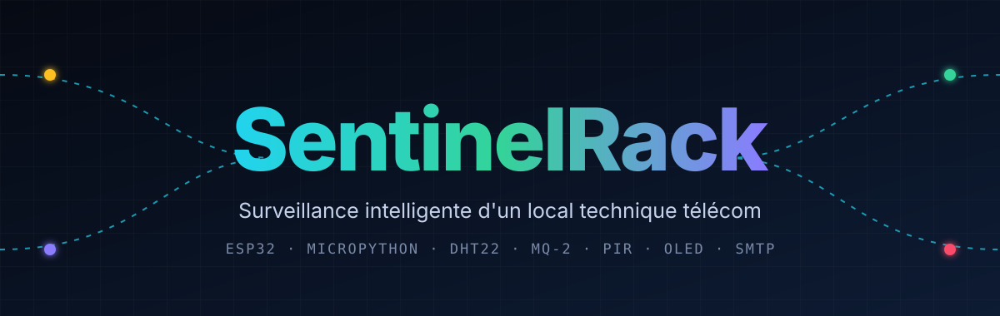
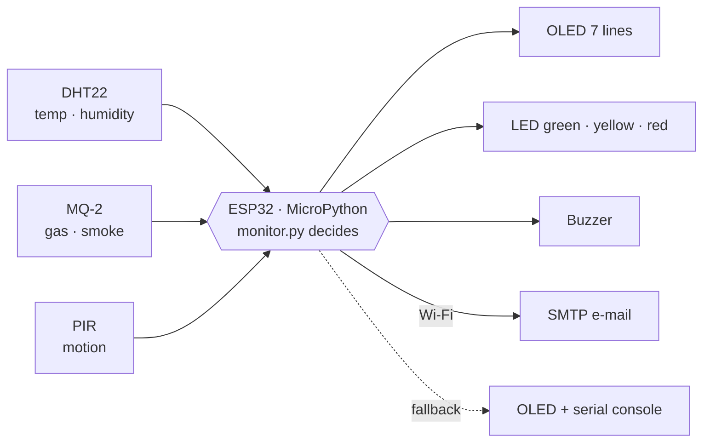
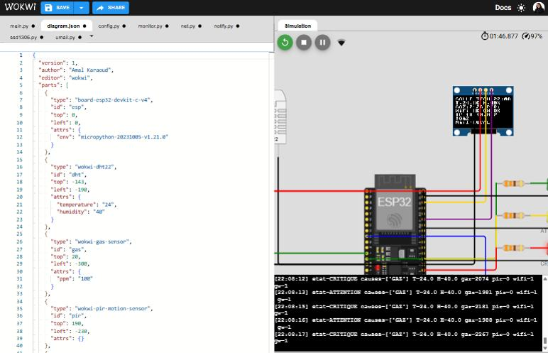
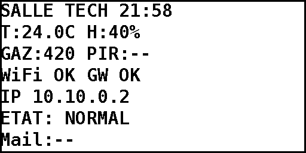
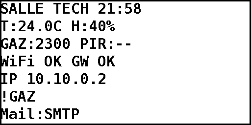
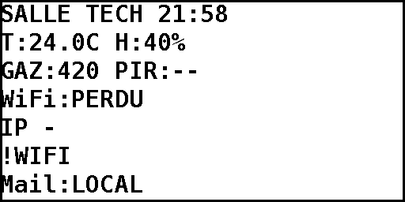
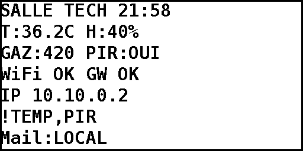

<div align="center">



**The night watchman of the telecom technical room.**
Temperature · gas/smoke · intrusion · Wi-Fi — monitored continuously, with light, sound and e-mail alerts.


### [▶ &nbsp;LAUNCH THE SIMULATION ON WOKWI](https://wokwi.com/projects/new/micropython-esp32) &nbsp;·&nbsp; [🌐 INTERACTIVE SITE](index.html) &nbsp;·&nbsp; [📚 DELIVERABLES](#-deliverables)

</div>

> **Wokwi link:** the button above opens a blank ESP32 MicroPython project. Replace `diagram.json` with
> [`wokwi/diagram.json`](wokwi/diagram.json), add the other files of [`wokwi/`](wokwi/), then press ▶ Start.
> (Once the project is saved publicly on Wokwi, put its URL here and in `index.html`, constant `WOKWI_URL`.)

## 🌐 Interactive presentation site
Open **[`index.html`](index.html)** in a browser (double-click it after cloning or downloading the repository).
It contains an animated step-by-step walkthrough, an animated architecture diagram, an interactive alert simulator
(intrusion, smoke, overheating, Wi-Fi loss — it replays the rules of `monitor.py` in JavaScript), the real Wokwi
screenshot with annotations, the slide viewer, the course traceability table and the jury Q&A.
It can be published with GitHub Pages (Settings → Pages → branch `main`, folder `/root`; private repositories need a plan that supports Pages).

## 🧭 How it works


| Level | Trigger examples | Output |
|---|---|---|
| 🟢 NORMAL | all values in range | green LED |
| 🟡 WARNING | T ≥ 28 °C · gas > 1500 · humidity out of 20–60 % · motion · Wi-Fi/gateway lost | yellow LED, short beep |
| 🔴 CRITICAL | T ≥ 35 °C · gas > 2000 · humidity > 80 % | red LED, fast beeps, e-mail |

## 🖼 Simulation screenshots
<table>
<tr><td width="58%"></td>
<td>Real run in Wokwi: code editor on the left, circuit top-right (OLED, ESP32, LEDs), serial console bottom-right showing state changes and causes.</td></tr>
</table>

| Normal | Gas critical | Wi-Fi lost | 36 °C + intrusion |
|---|---|---|---|
|  |  |  |  |

*OLED views are rebuilt from the real display function; the first image above is a genuine simulator capture.*

## 📚 Deliverables
| # | Deliverable | Files |
|---|---|---|
| 1 | Slides (16, with speaker notes) | [PowerPoint](livrables/1_Presentation_PowerPoint/Presentation_surveillance_local_technique.pptx) · [PDF](livrables/1_Presentation_PowerPoint/Presentation_surveillance_local_technique.pdf) |
| 2 | Full report | [Word](livrables/2_Rapport/Rapport_surveillance_local_technique.docx) · [PDF](livrables/2_Rapport/Rapport_surveillance_local_technique.pdf) |
| 3 | Detailed oral script (15 min) | [Word](livrables/3_Script_oral/Script_oral_surveillance_local_technique.docx) · [PDF](livrables/3_Script_oral/Script_oral_surveillance_local_technique.pdf) |
| 4 | Jury questions & answers | [Word](livrables/4_Questions_jury_et_reponses/Questions_jury_et_reponses.docx) · [PDF](livrables/4_Questions_jury_et_reponses/Questions_jury_et_reponses.pdf) |
| 5 | Wokwi project (diagram + code) | [`wokwi/`](wokwi/) |

Index in French: [`LIVRABLES.md`](LIVRABLES.md). Course traceability: [`docs/TRACABILITE.md`](docs/TRACABILITE.md).

## ✨ Features
- **Sensors:** DHT22 (temperature, humidity), MQ-2 (gas/smoke, critical threshold 2000), PIR (motion/intrusion).
- **Decision layer:** NORMAL / WARNING / CRITICAL with the list of active causes
  (`TEMP`, `HUM`, `GAS`, `PIR`, `WIFI`, `GW`, `DHT`); MQ-2 warm-up handling.
- **Outputs:** SSD1306 OLED over I2C (measurements, state, network, IP, time), green/yellow/red LEDs, buzzer.
- **Network:** Wi-Fi connection, NTP time, gateway check by TCP connection (ICMP ping is not available),
  automatic reconnection, Wi-Fi loss shown on the OLED.
- **Alerts:** SMTP e-mail (rate-limited per cause); fallback to OLED + serial console if sending fails.
- **Testable design:** all decisions live in `monitor.py` (no hardware access): 27 pytest tests on a PC,
  same code on the ESP32.

## 🗂 Repository layout
| Path | Content |
|---|---|
| `firmware/` | MicroPython code: `main`, `monitor`, `net`, `notify`, `umail`, `ssd1306`, `config` |
| `wokwi/` | `diagram.json` and a flat copy of the firmware for the simulator |
| `tests/` | pytest suite and a local fake SMTP server |
| `docs/` | course/lab traceability matrix, test results |
| `tools/` | figure and scenario generators |

## ▶ Run it
```
python3 -m pytest -q tests          # 27 tests on a PC
```
In Wokwi: new MicroPython/ESP32 project, replace `diagram.json`, add the files from `wokwi/`, start.
Serial console commands: `n` simulate a network outage, `m` test e-mail, `s` status, `g` network diagnostics.

## ✉ E-mail setup
Copy `firmware/mail_config_example.py` to `mail_config.py` and fill in your own SMTP settings
(Gmail requires an app password). This file is git-ignored: never commit it.
Without it, alerts stay on the OLED and in the serial console.

## ✅ Verified vs. not verified
- Verified in Wokwi: boot, Wi-Fi (IP 10.10.0.2, gateway 10.0.0.1), NTP time, gateway reachable on TCP port 53,
  Gmail SMTP ports reachable over TCP, local fallback.
- Not verified in Wokwi: authenticated e-mail delivery; PIR, out-of-range DHT22 and simulated-outage scenarios
  (covered by the PC tests). The simulated MQ-2 reads about 1900-2100 with noise whatever its ppm setting,
  so the state flickers around the 2000 threshold.

